# BDF Lab 3 - REST API, Query Parameters, Validation & Debugging

A complete Node.js + Express + SQLite implementation of Lab 3, continued from the Lab 2 `book` table approach.

---

## 🌐 Live Deployed API on Render

- **Primary Live Base URL:** [https://p-avinash-backend-lab-03.onrender.com/](https://p-avinash-backend-lab-03.onrender.com/)
- **Status:** Live & Active 🟢

### 🔗 Direct Browser-Clickable Live Links

| Endpoint Description | Method | Live URL |
|---|---|---|
| **Root Health & Endpoint Index** | `GET` | [https://p-avinash-backend-lab-03.onrender.com/](https://p-avinash-backend-lab-03.onrender.com/) |
| **All Books (Default List)** | `GET` | [https://p-avinash-backend-lab-03.onrender.com/books](https://p-avinash-backend-lab-03.onrender.com/books) |
| **Get Book by ID (`1`)** | `GET` | [https://p-avinash-backend-lab-03.onrender.com/books/1](https://p-avinash-backend-lab-03.onrender.com/books/1) |
| **Search Partial Title (`the`)** | `GET` | [https://p-avinash-backend-lab-03.onrender.com/books?search_q=the](https://p-avinash-backend-lab-03.onrender.com/books?search_q=the) |
| **Sort by Price Ascending** | `GET` | [https://p-avinash-backend-lab-03.onrender.com/books?order_by=price&order=ASC](https://p-avinash-backend-lab-03.onrender.com/books?order_by=price&order=ASC) |
| **Sort by Price Descending** | `GET` | [https://p-avinash-backend-lab-03.onrender.com/books?order_by=price&order=DESC](https://p-avinash-backend-lab-03.onrender.com/books?order_by=price&order=DESC) |
| **Sort by Title Descending** | `GET` | [https://p-avinash-backend-lab-03.onrender.com/books?order_by=title&order=DESC](https://p-avinash-backend-lab-03.onrender.com/books?order_by=title&order=DESC) |
| **Pagination: First 5 Books** | `GET` | [https://p-avinash-backend-lab-03.onrender.com/books?limit=5&offset=0](https://p-avinash-backend-lab-03.onrender.com/books?limit=5&offset=0) |
| **Pagination: Next 5 Books** | `GET` | [https://p-avinash-backend-lab-03.onrender.com/books?limit=5&offset=5](https://p-avinash-backend-lab-03.onrender.com/books?limit=5&offset=5) |
| **Price Filtering (₹100–₹500)** | `GET` | [https://p-avinash-backend-lab-03.onrender.com/books?min_price=100&max_price=500](https://p-avinash-backend-lab-03.onrender.com/books?min_price=100&max_price=500) |
| **Combined Query** | `GET` | [https://p-avinash-backend-lab-03.onrender.com/books?search_q=the&order_by=price&order=DESC&min_price=200&max_price=600&limit=5&offset=0](https://p-avinash-backend-lab-03.onrender.com/books?search_q=the&order_by=price&order=DESC&min_price=200&max_price=600&limit=5&offset=0) |
| **Error Test: Missing Book (404)** | `GET` | [https://p-avinash-backend-lab-03.onrender.com/books/99999](https://p-avinash-backend-lab-03.onrender.com/books/99999) |
| **Error Test: Invalid ID (400)** | `GET` | [https://p-avinash-backend-lab-03.onrender.com/books/abc](https://p-avinash-backend-lab-03.onrender.com/books/abc) |
| **Error Test: Invalid Query (400)** | `GET` | [https://p-avinash-backend-lab-03.onrender.com/books?order_by=invalid](https://p-avinash-backend-lab-03.onrender.com/books?order_by=invalid) |
| **Error Test: Undefined Route (404)**| `GET` | [https://p-avinash-backend-lab-03.onrender.com/unknown-route](https://p-avinash-backend-lab-03.onrender.com/unknown-route) |

---

## Requirements covered

- Resource-based noun endpoint: `/books`; HTTP methods represent actions.
- `GET /books` supports `search_q`, `order_by`, `order`, `limit`, and `offset`.
- Defaults: `search_q=""`, `order_by=id`, `order=ASC`, `limit=10`, `offset=0`.
- Partial title search uses SQL `LIKE`.
- Price range supports `min_price` and `max_price` (inclusive conditions equivalent to `BETWEEN`).
- POST and PUT validate title, author and numeric price.
- Status codes: 201 create; 200 read/update/delete; 400 invalid input; 404 missing book.
- Consistent JSON error format: `{ "message": "..." }`.
- SQL values use parameterized queries. Sort column and direction are validated against allowlists.
- Database initialization and database reads/writes are awaited.

## Setup (Windows CMD / VS Code terminal)

1. Extract the ZIP.
2. Open the extracted `lab-03-rest-api` folder in VS Code.
3. Install dependencies:
   ```bash
   npm install
   ```
4. Start the server:
   ```bash
   npm start
   ```
   For development with auto-restart:
   ```bash
   npm run dev
   ```
5. Open `http://localhost:3000/`. The SQLite database `data/books.db` is created automatically and seeded with 10 sample books on the first run.

If port 3000 is busy, run:
```cmd
set PORT=3001 && npm start
```
Then use `http://localhost:3001`.

## API endpoints

| Method | Endpoint | Purpose |
|---|---|---|
| GET | `/books` | List, search, sort, filter and paginate |
| GET | `/books/:id` | Get one book |
| POST | `/books` | Create a book |
| PUT | `/books/:id` | Update a book |
| DELETE | `/books/:id` | Delete a book |

### GET query parameters

| Parameter | Default | Example |
|---|---|---|
| `search_q` | empty | `?search_q=code` |
| `order_by` | `id` | `?order_by=price` |
| `order` | `ASC` | `?order=DESC` |
| `limit` | `10` | `?limit=5` |
| `offset` | `0` | `?offset=5` |
| `min_price` | none | `?min_price=200` |
| `max_price` | none | `?max_price=500` |

Combined example:
`GET http://localhost:3000/books?search_q=the&order_by=price&order=DESC&min_price=200&max_price=600&limit=5&offset=0`

Allowed `order_by`: `id`, `title`, `author`, `price`. Allowed `order`: `ASC`, `DESC`. `limit` must be 1–100; `offset` must be a non-negative integer.

## Postman testing

Import `postman/Lab-03-Books-API.postman_collection.json` into Postman. Set `baseUrl` to `http://localhost:3000` if needed. Run requests in the collection. The collection includes successful and failure cases for list/search/filter, CRUD, validation, invalid sort/pagination, and missing IDs.

### Sample request body
```json
{
  "title": "Learning Node.js",
  "author": "P. Avinash",
  "price": 399
}
```

### Example responses

Successful create (201):
```json
{
  "message": "Book added successfully",
  "id": 11
}
```

Validation failure (400):
```json
{ "message": "Title is required" }
```

Missing record (404):
```json
{ "message": "Book not found" }
```

## Debugging exercise - issue and resolution

1. **EADDRINUSE (port already in use):** Another process is using the selected port. Stop the old Node process (Ctrl+C in its terminal) or start with another port using `set PORT=3001 && npm start`.
2. **Wrong import path:** Check the relative path and filename. The route imports `../database` from `src/routes/books.js`, which correctly resolves to `src/database.js`.
3. **No such table:** Ensure the table name is exactly `book` (singular) in both table creation and SQL queries. The database setup runs before the server starts.
4. **Missing await:** Await asynchronous database operations such as `db.get`, `db.all`, `db.run`, and `openDatabase()` before using their results.

**Screenshots requires:**
Task 1: Get all books
Displays all books stored in your SQLite database.
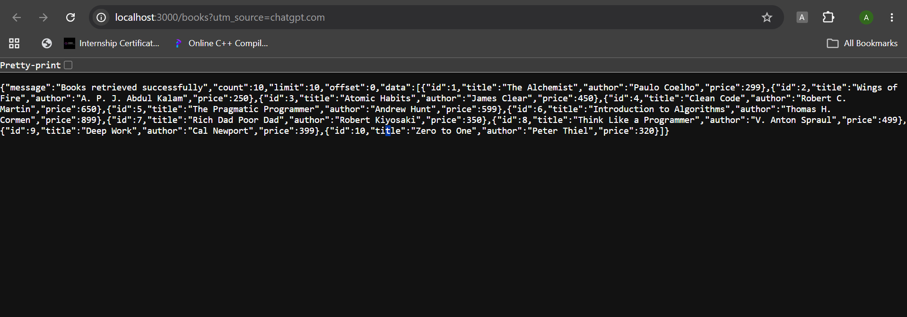

Task 2: Search books
Search books using a partial title.
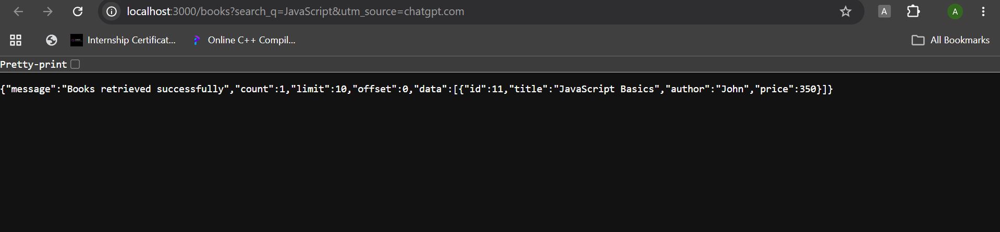

Task 3: Sorting books
Sort books by price in ascending order.

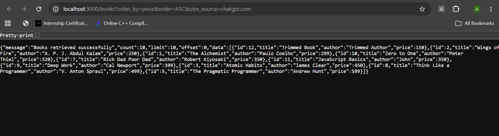

Sort books by title in descending order.
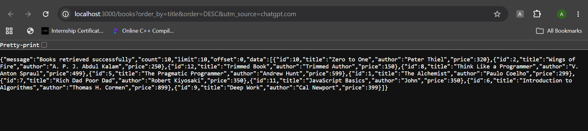

Task 4: Pagination
Get the first five books.
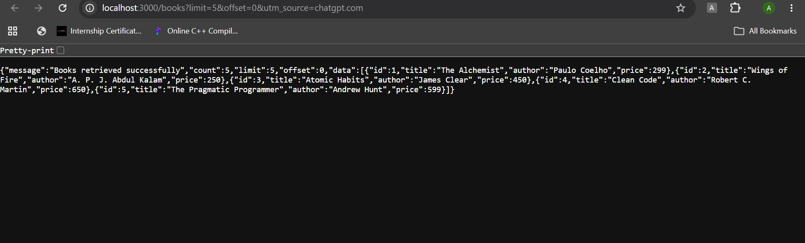

Get the next five books.
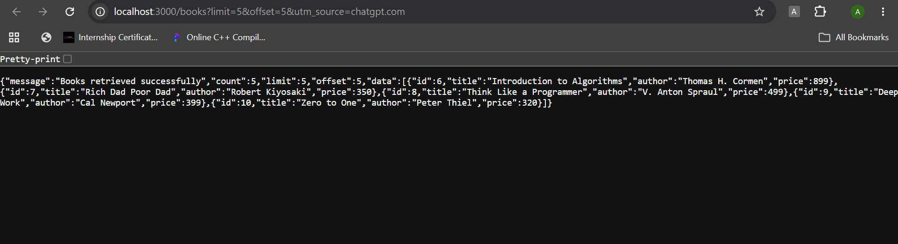


Task 5: Price-range filtering
Get books priced between ₹100 and ₹500.
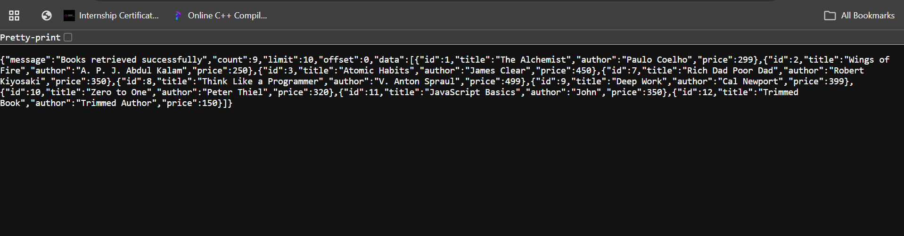

Get books costing ₹200 or more.
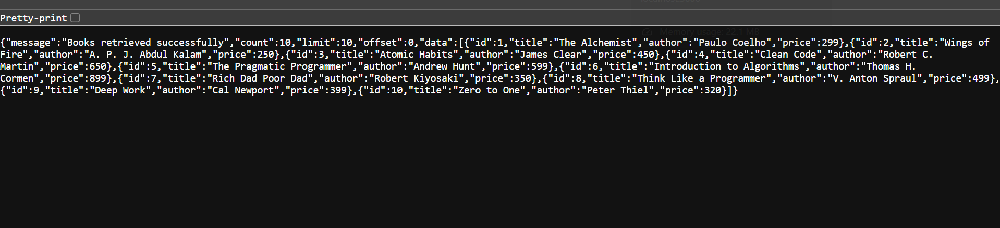


Task 6: Combined query parameters
You can combine searching, sorting, pagination and price filtering.

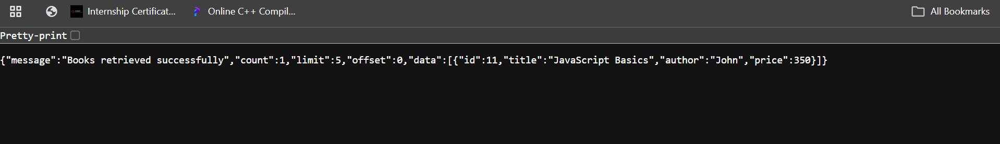

Task 7: HTTP status codes and validation
These endpoints need different HTTP methods, so use Postman rather than opening them directly in your browser.

Create book
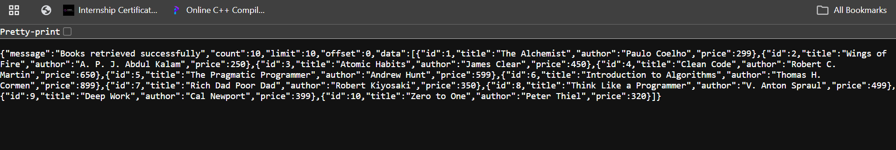


update book
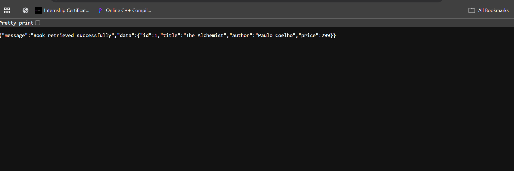

update missing id
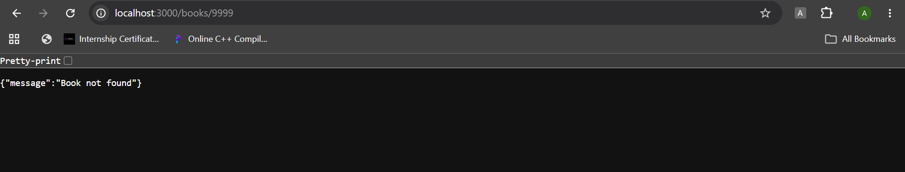

Delete missing id


Missing titles
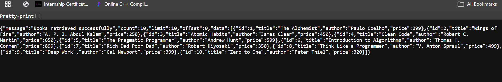

## Viva preparation

- **Query parameter vs path parameter:** Query parameters follow `?` and are commonly used for filtering/sorting/pagination (for example, `/books?limit=5`). A path parameter is part of the URL path and identifies a resource (for example, `/books/3`).
- **Stateless:** Each HTTP request contains the information needed to process it; the server does not depend on stored client session state from a previous request.
- **Bad input vs missing record:** `400 Bad Request` for invalid input; `404 Not Found` when the requested resource does not exist.

## Submission notes

- Do not commit `.env` or `node_modules`.
- `node_modules` is intentionally excluded from this ZIP; run `npm install`.
- `data/books.db` is generated automatically at first launch.
- Capture your own Postman screenshots after running the API if your faculty requires visual testing evidence.
